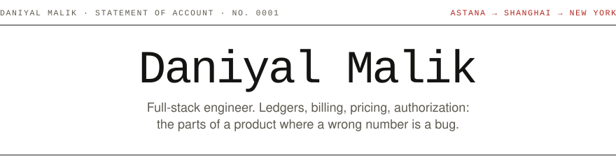
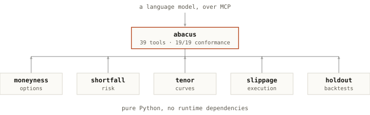

<picture>
  <source media="(prefers-color-scheme: dark)" srcset="assets/header-dark.svg">
  
</picture>

Computer science and economics at New York University, class of 2028. Two years at NYU Shanghai, now at the New York campus. Over the past year: founding engineer, engineering lead and co-founder on three early-stage products in New York, Shanghai and France, mostly building the parts that handle money and permissions — billing, bookings, role systems — on Next.js and PostgreSQL.

<a href="mailto:dm6008@nyu.edu">dm6008@nyu.edu</a> · <a href="https://daniyalmlk.github.io">daniyalmlk.github.io</a> · <a href="https://linkedin.com/in/daniyal-mlk">LinkedIn</a>

## Work

| Date | Role |
| :-- | :-- |
| Nov&nbsp;2025&nbsp;–&#8288;&nbsp;now New York | **[Terran Denizen](https://terrandenizen.com)** · Full-Stack Engineering Intern Career platform for MBA students at the M7 business schools. Founding engineer and largest contributor on a six-service platform: four Next.js apps, a Node API and an iOS app on one PostgreSQL. Shipped member applications, trek booking and Stripe subscription billing with refund sync; built the four-tier role system as 133 row-level security policies; closed a cross-subdomain session-hijacking path; own the iOS release pipeline. |
| Jun&nbsp;–&#8288;&nbsp;Oct&nbsp;2026 China | **[AidenCare](https://aidencare.space)** · Full-Stack Engineering Lead Bilingual patient portal and staff dashboard for a dental clinic in Shanghai. Led the build with one other engineer: set the architecture, split the work, reviewed the code. Designed the appointment lifecycle from request to payment, with a database constraint that makes double-booking impossible; six roles with an approval workflow; an LLM assistant that answers only from data its user's role can see. |
| Feb&nbsp;–&#8288;&nbsp;May&nbsp;2026 France | **SolveSim** · Co-founder Timed, McKinsey-style case-interview simulator, used by 250+ candidates with 8% on paid plans. Stored attempts as append-only records and derived scores from them, so scoring rules change without migrations; three-tier Stripe subscriptions with plan limits in one config, enforced by middleware. |

## Open source

Nine libraries, mostly finance: ledgers, pricing, risk, execution. Six form one system — **abacus** hands moneyness, tenor, shortfall, slippage and holdout to a language model as tools, so the numbers are computed by tested code rather than by the model. Each is published with its own output; the pinned repositories are the place to start, and the full runs are on [daniyalmlk.github.io](https://daniyalmlk.github.io#projects).

  <picture>
    <source media="(prefers-color-scheme: dark)" srcset="assets/ecosystem-dark.svg">
    
  </picture>

## Stack

**Languages** &nbsp;TypeScript · JavaScript · Python · SQL · C++ 
**Building** &nbsp;Next.js · React · React Native · Expo · Node · Deno · Tailwind 
**Data** &nbsp;PostgreSQL · Supabase · Prisma · Row-level security · pandas · NumPy 
**Shipping** &nbsp;Git · Vercel · Stripe · EAS Build · App Store Connect · MCP

---

Balance carried forward. New York, NY. &nbsp;·&nbsp; Closing balance: <b>all accounts reconciled</b>
